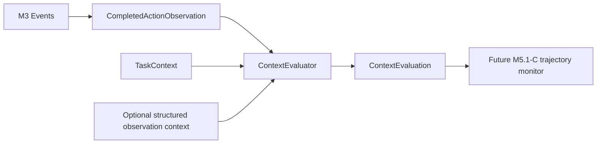

# Context Evaluation

## Purpose and boundary

M5.1-B implements deterministic interpretation of one canonical completed action
observation relative to one trusted `TaskContext`. It does not authorize actions,
change context, retain history, count attempts, or emit trajectory findings.

The layers remain distinct:

| Layer | Question answered |
|---|---|
| `TaskContract` and M2 policy | Is this action authorized? |
| `TaskContext` | What trusted semantic declarations exist? |
| `ContextEvaluator` | How does this completed observation relate to those declarations? |
| Future M5.1-C monitor | What does the ordered sequence mean? |

`ContextEvaluator` never emits `ALLOW`, `DENY`, `QUARANTINE`, or another enforcement
outcome. Its copied `policy_decision` and `executed` fields report what already happened.

## Inputs

The canonical input is M5's immutable `CompletedActionObservation`, derived from a
terminal M3 event. The evaluator uses its task, request, action, resource, decision,
execution, sequence, and canonical event identities. A task ID mismatch raises
`TaskContextMismatchError`; an inconsistent completed decision/execution pair raises
`ContextEvaluationError`.

`ObservationContext` is optional immutable metadata supplied separately from canonical
telemetry. It can carry a controlled action-purpose identifier, declared data-role
identifiers, or a `LogicalDataFlow`. It never replaces or mutates the observation.
Logical flow is an assertion that can be compared with a declaration; it is not
inferred from event order and is not proof of byte or payload lineage.

## Result schema

`ContextEvaluation` is a frozen, slotted value containing:

- observation binding: task, request, sequence, and canonical event IDs;
- the original policy decision and execution outcome;
- one aggregate `ContextEvaluationStatus`;
- matched resource, data, destination, action-purpose, and fallback identifiers;
- ordered trusted `ContextSource` records used by matched declarations;
- explicit missing dimensions; and
- ordered `ConstraintEvaluation` evidence with a dimension, status, stable `CTX-*`
  reason ID, observed value, declaration identity, and source where applicable.

The aggregate precedence is `CONTEXT_MISMATCH`, then `INSUFFICIENT_CONTEXT`, then
`CONTEXT_CONSISTENT`, then `NOT_APPLICABLE`. This prevents one successful dimension
from hiding a conflict or abstention. The aggregate is an interpretation state, not a
safety, intent, or trajectory classification.

## Dimension semantics

### Resource and data roles

For local actions, the evaluator calls `TaskContext.role_for` and therefore preserves
M2 exact/subtree scope boundaries. A matching `ResourceRole` exposes its role and
optional data role without inspecting names or contents. No resource declarations is
insufficient context; declarations that exist but do not cover the observed resource
produce a mismatch. For a destination action, the resource field is interpreted as the
destination and the separate resource dimension is not applicable.

### Destination, outcome, and action purpose

`network.send` is the canonical outbound action in this milestone. An action also uses
destination evaluation when its context contains a destination constraint for that
action. No destination semantics for a required outbound action is insufficient
context. Existing destination semantics that do not cover the resource are a mismatch;
a destination declared for another action produces the distinct
`CTX-DESTINATION-ACTION-MISMATCH` reason.

A matched destination preserves its destination identity, destination purpose, and
source. The task must declare outcomes, and the destination must relate at least one of
them to the action. Absent task outcome context is insufficient; an intentionally empty
destination outcome relation is a mismatch. Supplied data roles and action purposes are
compared with the destination declaration. No payload is inspected, and absent supplied
data roles do not imply that any particular data was transferred.

Expected action purposes are compared only as controlled identifiers. The evaluator
does not infer purpose from action names or descriptions. When a relationship is
declared and no observed purpose is supplied, the result exposes the declared compatible
purpose set. A supplied conflicting identifier, or a destination with no declared
action-purpose relationship where task-level purposes exist, produces
`CTX-ACTION-PURPOSE-MISMATCH`.

### Fallback

Fallback evaluation applies only to denied, unexecuted observations. One observation
can match one declared `FallbackPattern` by action, candidate scope, resource role, and
supplied controlled purpose when present. The result exposes the behavior identifier,
candidate scopes, and declaration source. It does not count attempts or decide whether a
bound has been exceeded. No fallback declarations for a denied observation is
insufficient context; declarations that do not cover the observation produce
`CTX-FALLBACK-UNDECLARED`, while a supplied purpose that conflicts with an otherwise
matching pattern produces `CTX-FALLBACK-PURPOSE-MISMATCH`.

### Data flow

When a `LogicalDataFlow` is supplied, it must match a declared source-role set, derived
data role, destination purpose, and action purpose. With no supplied assertion, the
dimension is not applicable. With an assertion but no flow declarations, it is
insufficient. A conflicting assertion is a mismatch. Observation ordering alone never
creates a flow assertion.

## Determinism, provenance, and limitations

The evaluator is a frozen stateless service with no timestamps, randomness, caches, or
trajectory state. Equivalent observation, context, and optional metadata values produce
equal semantic results. Evidence preserves sources for the task purpose and every
matched resource, data-role, outcome, action-purpose, destination, flow, or fallback
declaration used in interpretation.

M5.1-B does not authenticate context issuers, load context documents, parse natural
language, use an LLM or embeddings, inspect files/rows/payloads/prompts/model outputs,
infer actual lineage, recognize intent, count behavior, modify TRJ-001/TRJ-002, emit a
finding, suppress an M5 finding, change capabilities, or grant authority. Those limits
are part of the scientific boundary rather than implementation omissions to infer away.
