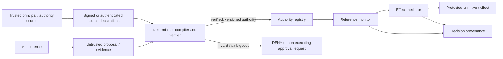

# SafetyBox AI–Deterministic Trust Boundary

## Status

**Specification identity:** `SAFETYBOX-AI-DETERMINISTIC-TRUST-BOUNDARY@1`

**Specification date:** 2026-09-25

This is a future architecture and research specification. SafetyBox does not currently
implement AI-to-authority compilation, authenticated issuers, an approval service, or
Authority V2. The existing `TaskContractPolicy` remains the bounded in-process
authorization implementation described in [Task Contract](TASK_CONTRACT.md).

## Boundary rule

AI output is untrusted **proposal or evidence**, never authority. Only a trusted,
deterministic verifier operating on authenticated external authority sources may create
an enforcement-eligible authority object.



No edge from AI inference, prompts, memory, retrieved context, trajectory findings, or
agent self-report goes directly to the authority registry, reference-monitor `ALLOW`, or
effect mediator.

## Permitted and prohibited AI roles

AI **may**:

- interpret the user's requested task;
- inspect repository or environment semantics through already authorized reads;
- propose candidate actions, resources, roles, constraints, or capability templates;
- classify semantic roles and analyze trajectories;
- identify suspiciousness or uncertainty;
- explain deterministic decisions using recorded facts and clearly label generated
  rationale;
- recommend external approval; and
- summarize the authority delta and risk for an approver.

AI **may not**:

- grant, sign, activate, renew, or revoke authority;
- expand a capability or maximum-privilege ceiling;
- amend a `TaskContract` or authority object in place;
- override or reinterpret a deterministic `DENY` as permission;
- silently convert prompt, memory, retrieved content, tool output, semantic context, or
  history into authority;
- assert an identity, delegation, approval, or provenance fact without trusted evidence;
  or
- cause a protected effect merely because a model recommends it.

These boundaries specialize `INV-026` (no agent self-expansion) and `INV-028` (AI/context
cannot grant authority). Existing `INV-009`, `INV-013`, `INV-014`, and `INV-015` remain
consistent with this boundary.

## AI-to-authority compilation abstraction

### Inputs

The proposed compiler consumes two strictly separated channels:

1. **Trusted declarations**: authenticated principal/task identity, issuer grant scope,
   system policy, registered resource/tool identity, maximum privilege, and any external
   approval.
2. **Untrusted proposal**: an AI-produced structured candidate containing task
   interpretation, candidate actions, resource scopes, constraints, and rationale.

The AI proposal must carry no field whose presence alone is treated as proof of identity,
ownership, approval, delegation, or resource authority.

### Deterministic verification pipeline

For compiler version `v`, trusted input `t`, proposal `p`, and state `s`:

```text
Compile_v(t, p, s) -> VERIFIED(authority)
                    | REJECT(reason)
                    | REQUIRE_EXTERNAL_APPROVAL(delta)
```

`VERIFIED` is permitted only when all checks succeed:

1. **Schema:** canonical types, version, identifiers, constraint algebra, and no unknown
   security-significant fields.
2. **Authority source:** authenticated issuer exists and is authorized to grant the
   proposed set.
3. **Identity and task binding:** principal, agent/session where required, and task
   instance are authenticated rather than inferred from matching strings.
4. **Canonical scope:** every action, resource, destination, executable, and tool identity
   has an unambiguous registered interpretation.
5. **Subset/no amplification:** the denoted request set is provably a subset of issuer
   authority and the task maximum.
6. **Attenuation and delegation:** parent linkage, depth, subject change, and constraints
   obey [Authority Model V2](../research/SAFETYBOX_AUTHORITY_V2_RESEARCH_SPEC.md).
7. **Temporal and usage constraints:** issue/expiry bounds and usage limits are valid and
   enforceable by trusted state.
8. **Provenance:** compiler, inputs, hashes, issuer, approval, rule, and resulting object
   are reconstructable.
9. **Policy constraints:** mandatory denials and organizational ceilings hold.
10. **Ambiguity:** unknown canonicalization, incomparable constraints, missing evidence,
    or conflicting declarations cannot silently produce `VERIFIED`.

The compiler must use a typed constraint language with a sound subset procedure. It must
not attempt to prove arbitrary natural-language implication. If `child <= parent` cannot
be established mechanically, `INV-031` requires rejection or a non-executing external
resolution path.

### Authority activation

Compilation and activation are distinct commits. A compiled object enters enforcement
only after integrity protection, registry commit, version assignment, and required audit
commit succeed. The reference monitor consumes the committed object or an exact snapshot;
it never reinterprets the AI rationale. A later proposal cannot mutate that object.

## Approval is authority creation

`REQUIRE_EXTERNAL_APPROVAL` does not permit execution. It packages the exact denied or
insufficient request, current authority, proposed authority delta, constraints, expiry,
and consequences for an authenticated principal.

An approval is valid only if the approver is independently authenticated and holds grant
authority covering the complete delta. Approval produces a new versioned authority object
or contract revision, after which the original request is normalized and authorized
again. It never bypasses policy, edits a decision event, or lets the agent approve itself.

## Decision composition

The minimum precedence is:

```text
identity/integrity failure or ambiguity -> no execution
deterministic prohibition              -> DENY
absent/insufficient authority          -> DENY or REQUIRE_EXTERNAL_APPROVAL
AI suspicion/evidence                  -> FLAG, approval recommendation, or
                                          policy-defined attenuation only
verified covering authority            -> eligible for deterministic evaluation
```

AI confidence is not an authority weight. Multiple weak proposals do not combine into a
grant. An AI recommendation cannot turn `DENY` into `ALLOW`; at most, an authorized
external workflow creates a new authority version and triggers fresh evaluation.

## Context and trajectory boundary

Prompt text, retrieved documents, memory, B4 historical context, and trajectory findings
may affect analysis. Trusted policy may use a registered finding to reduce future
authority, pause execution, or request approval. They may not expand authority. A
restriction path must name its deterministic rule and remain reversible only under
defined external authority semantics.

This preserves the existing principle that `TaskContext` and B4 declarations have no
authorization meaning. A future context-poisoning benchmark should hold external
authority fixed while varying prompt/memory content and verify that authorization is
unchanged.

## Failure semantics

| Failure | Required result |
|---|---|
| Malformed or unsupported proposal | `REJECT`; no authority object |
| Missing/untrusted authority source | `REJECT`; no approval inferred |
| Identity or task binding not authenticated | `REJECT` or explicit non-executing resolution |
| Resource/action cannot be canonicalized uniquely | `REJECT` |
| Subset relation unknown or false | `REJECT` |
| Approval unavailable/expired/out of scope | request remains unexecuted |
| Registry or required provenance commit fails | authority not activated |
| Model unavailable or changes answer | deterministic existing authority remains unchanged |
| Deterministic verifier error | fail closed for the pending protected action |

## Model-release resilience property

For fixed trusted declarations, compiler/verifier version, enforcement state, and
candidate canonical authority set, replacing model `M1` with model `M2` must not change
the set accepted by deterministic verification:

```text
Verify_v(trusted, candidate, state) is independent of model identity or confidence.
```

A stronger model may propose a better or narrower candidate and improve task completion.
It may also find more bypass attempts, increasing the need for mediator testing. It does
not change authorization semantics, reference-monitor precedence, effect constraints, or
the maximum privilege ceiling. Model-release evaluations should separately measure
proposal quality, benign completion, denial attempts, and discovered bypasses.

## Research questions

1. Can probabilistic task interpretation be converted into deterministic least-authority
   capability sets without unacceptable false denies or approval burden?
2. Which typed resource and constraint algebras support sound, useful subset proofs?
3. How should the compiler represent uncertainty without silently widening scope?
4. Can independent proposal models improve capability recall while the deterministic
   verifier preserves no-amplification?
5. How do proposal quality and attack behavior change across stronger model releases while
   authority outcomes remain stable for identical canonical inputs?
6. What information must an approval interface expose for a human to understand the exact
   authority delta?

## Evidence required before claims

Evidence must include compiler conformance and property tests, adversarial malformed and
amplification proposals, authenticated-source tests, context invariance pairs, approval
scope tests, version/replay tests, and end-to-end effect evidence through named mediators.
AI proposal accuracy alone cannot support an unauthorized-effect-prevention claim.
