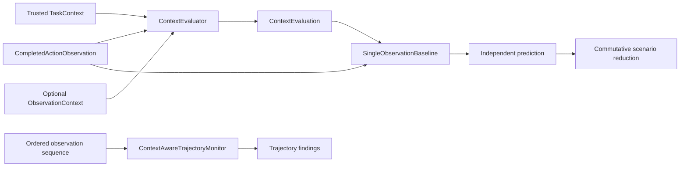

# Single-Observation Context Baseline

## Purpose

`B2-SINGLE-OBSERVATION@1` is the frozen executable history-free context baseline. It
answers how much contextual inconsistency can be classified from each completed action
in isolation, using the trusted semantic interpretation already produced by M5.1-B.
It is the executable B2 comparator required before the EXP-013 held-out corpus is
authored. It is not a safety, intent, authorization, or maliciousness classifier.



The lower path is deliberately not part of B2. B2 imports neither the context-aware
trajectory monitor nor its rules or state.

## Frozen observation semantics

Each observation is evaluated by the unmodified M5.1-B `ContextEvaluator`. B2 then maps
only that observation's aggregate `ContextEvaluationStatus`:

| Context evaluation | B2 prediction | Meaning |
|---|---|---|
| `CONTEXT_MISMATCH` | `POSITIVE` | At least one deterministic single-observation context constraint conflicts. |
| `CONTEXT_CONSISTENT` | `NEGATIVE` | This observation supplies no history-free positive signal. |
| `INSUFFICIENT_CONTEXT` | `ABSTAIN` | The declarations needed for a classification are incomplete. |
| `NOT_APPLICABLE` | `NEGATIVE` | No applicable mismatch exists; this status is never treated as a mismatch. |

`POSITIVE` and `NEGATIVE` describe the baseline condition only. They do not mean
`MALICIOUS` or `SAFE`. Reason IDs whose constraint status matches the aggregate status
are retained. The result also retains all M5.1-B trusted sources, matched roles and
destination identifiers, action/resource identity, canonical provenance, and the
already-recorded policy decision/execution outcome. None of those fields is parsed as
natural language or used as a static task-category shortcut.

## Allowed information

B2 may receive one immutable `CompletedActionObservation`, the trusted `TaskContext`,
optional structured `ObservationContext`, and the resulting M5.1-B
`ContextEvaluation`. This makes the current action, current resource, matched resource
and data roles, matched destination declaration, aggregate status, deterministic reason
IDs, and trusted source provenance auditable. Task binding is enforced by M5.1-B.

The classifier does not parse task descriptions, resource or destination names, human
rationales, or other natural language. It contains no task-purpose, category, family,
scenario, corpus, or experiment-identifier branches. There is no NLP, regular
expression, LLM, payload inspection, or inferred lineage.

## Forbidden history information

B2 does not consume or derive:

- previous, future, first, last, or neighboring observations;
- observation order, index, sequence-number magnitude, or number of predecessors;
- accumulated roles, cross-observation groups, or resource combinations;
- counts, repetition strength, fallback-attempt count, or trajectory length;
- phases, transitions, final actions, or destination changes over time; or
- context-aware trajectory findings or `CTXTRJ-*` rule state.

The observation sequence number is copied only as canonical provenance and is checked
when a precomputed evaluation is paired with an observation. The prediction mapping
does not read its value.

## Scenario aggregation

One scenario prediction is the commutative, idempotent reduction of its independently
computed observation predictions:

```text
POSITIVE if any independent result is POSITIVE
else ABSTAIN if any independent result is ABSTAIN
else NEGATIVE
```

The implementation first converts results to a `frozenset`. Exact duplicate results
therefore collapse, and the reduction considers only prediction membership—not order or
multiplicity. Repeating an identical result cannot strengthen or change a prediction.
Permuting results cannot change either the prediction or returned evidence collection.
The reducer rejects an empty collection and mixtures of session or task identities;
those identifiers bind evidence but do not classify it.

## Determinism and configuration

There is no behavior configuration. The status mapping, scenario precedence, and
identifier are constants of version `B2-SINGLE-OBSERVATION@1`. No timestamps,
randomness, mutable cache, retained observations, counters, or state transitions exist.
Equivalent inputs produce equal immutable observation results, and equivalent result
sets produce equal immutable scenario results regardless of iteration order.

## Authorization separation

B2 is observational. It copies the prior policy decision and execution flag for audit,
but it cannot authorize, deny, execute, contain, grant capabilities, mutate a
`TaskContract`, or alter `TaskContext`. `ContextEvaluator` remains the sole owner of
resource, destination, data-role, action-purpose, flow, and fallback interpretation.

## Relationship to trajectory reasoning

M5.1-C retains bounded ordered session/task state and emits findings from relationships
across observations. B2 terminates at M5.1-B and emits no trajectory finding. A trace of
individually consistent observations remains `NEGATIVE` under B2 even when a
hypothetical ordering, phase boundary, accumulation, or repetition relationship would
matter to a trajectory detector.

## Limitations

B2 cannot detect ordering, accumulation, grouping, repeated progression, phase change,
or any other genuinely multi-step relationship. It inherits M5.1-B's structured-context
coverage and trust assumptions. Incomplete context abstains. Context that is stale but
still internally consistent is not recognized as stale unless its structured contents
produce an explicit mismatch; B2 makes no freshness claim. A positive identifies a
context mismatch, not malicious intent, causal transfer, or deployment risk.

EXP-012 may be used only as contaminated development regression evidence for this
baseline. It cannot become new held-out evidence. EXP-013 uses B2 as the frozen primary
single-observation comparator; the held-out corpus and results remain separate future
work.

## Contaminated development regression

After implementation, B2 was run in memory over the 80 frozen EXP-012 primary scenarios
using their existing completed-action inputs, structured observation context, and
trusted task context. Labels were loaded only after all B2 predictions. The frozen
reduction reproduced the prior adversarial-analysis observation: all 40 trajectory
positives produced `POSITIVE`, all 40 trajectory negatives produced `NEGATIVE`, and no
primary scenario abstained. This is a regression check against already inspected data,
not new evidence, a new EXP-012 result, or an EXP-013 run. No result artifact was
created.
