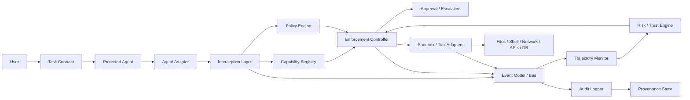

# System Architecture

## Status and intent

This document specifies a logical architecture, not an implemented system, except where explicitly marked. SafetyBox is intended to mediate every privileged external action of a protected agent. Its core enforcement does not trust the agent's stated intent and does not require an LLM.

## Implemented in M1/M2: in-process authorization kernel

M1 implements only a framework-neutral, in-process `ReferenceMonitor` API. It receives an immutable `ActionRequest`, obtains a `PolicyDecision` from an `Authorizer`, and forwards the exact request to a `ProtectedTool` only for `ALLOW`. A `DENY` returns an `EnforcementResult` without tool invocation. Authorizer exceptions raise `AuthorizationFailure` and fail closed before tool invocation.

This is not an implementation of the full logical architecture in the diagram. In particular, M1 has no agent adapter, interception deployment, capability registry, event bus, audit persistence, trajectory/risk engine, approval path, sandbox, or protection against callers that possess a direct reference to a tool. Its tests establish ordering and denial properties only inside this in-process abstraction.

M2 adds an immutable task contract and explicit action/resource capabilities as an `Authorizer` implementation. The monitor forwards only requests allowed by the contract's deterministic capability evaluation. This remains logical in-process authorization: it is not an adapter, capability registry, filesystem implementation, or OS-level confinement mechanism.

M3 adds an in-process immutable event/audit foundation to this same API. Each monitor lifecycle is emitted in session-local sequence order to an injected or default in-memory audit recorder. It records request attribution, policy decision/rule provenance, and execution outcome, but is not a durable event bus or provenance store.

The arrows describe logical information/control flow. A deployment must place the interception layer so the agent has no alternate privileged path to resources.

## Logical components

1. **Task Contract:** versioned declaration of goals, prohibitions, authority, limits, approvals, expected behavior, and termination conditions.
2. **Agent Adapter:** translates framework-specific calls into canonical requests without granting authority.
3. **Interception Layer:** mandatory pre-execution mediation point; rejects malformed or unidentifiable requests.
4. **Capability Registry:** resolves current actor/action/resource authority, constraints, expiry, and revocation.
5. **Policy Engine:** deterministically evaluates normalized request, contract, capabilities, context, and policy version.
6. **Event Bus/Event Model:** orders canonical observations and distributes them to monitoring and audit consumers.
7. **Behavioral/Trajectory Monitor:** evaluates patterns over ordered events rather than isolated requests.
8. **Risk/Trust Engine:** maintains an experimental operational state used to reduce authority; it is not a validated intent score.
9. **Enforcement Controller:** combines decisions under explicit precedence and applies the selected outcome.
10. **Audit Logger:** records requests, decisions, rule identifiers, transitions, and results.
11. **Provenance Store:** preserves lineage across tasks, sessions, policy/configuration versions, events, and artifacts.
12. **Approval/Escalation mechanism:** routes pending decisions to an authorized principal with bounded context and expiry.
13. **Sandbox/tool adapters:** execute approved operations while enforcing normalized arguments and reporting actual results.

## Enforcement outcomes

| Outcome | Semantics |
|---|---|
| `ALLOW` | Forward this exact normalized request under existing limits. |
| `DENY` | Do not forward the request; record the reason. |
| `ALLOW_WITH_LIMITS` | Forward only after applying explicit narrower parameters or resource/quantity limits. Never broaden the request. |
| `REQUIRE_APPROVAL` | Hold without execution until an authorized, scoped, unexpired approval or denial arrives. |
| `DEGRADE_CAPABILITIES` | Atomically reduce future session capabilities, then re-evaluate the pending request if policy specifies. |
| `PAUSE` | Stop new external actions while preserving resumable session state. |
| `QUARANTINE` | Isolate the session and revoke privileged external actions pending investigation. |
| `TERMINATE` | Irreversibly end the SafetyBox session and reject subsequent requests. |

These outcomes are semantic requirements only. Conflict precedence, atomicity, and failures are defined in [Controller](CONTROLLER.md) and [Failure Modes](FAILURE_MODES.md).

## Data and control guarantees sought

- Authorization completes before side effects.
- Authority is derived from the task contract and current capability state, never from an agent request alone.
- Capabilities may be attenuated during a session but cannot silently expand.
- Decisions and transitions emit attributable, ordered audit events.
- Optional semantic signals cannot bypass deterministic prohibitions.
- Deployment assumptions and unmediated channels remain explicit.

See [Safety Invariants](SAFETY_INVARIANTS.md) for desired properties and verification status.
