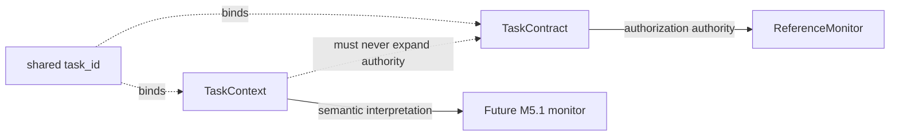

# Task Context

## Purpose and boundary

M5.1-A implements `TaskContext` as immutable, externally supplied semantic context. It
answers **“How should this action be interpreted relative to the task?”** It does not
answer **“May this action occur?”** That remains the exclusive role of `TaskContract`,
`CapabilityEvaluator`, and `ReferenceMonitor`.

M5.1-B now connects `TaskContext` only to the stateless observational
[`ContextEvaluator`](CONTEXT_EVALUATION.md). It does not connect context to
authorization or to `TrajectoryMonitor`, and adds no finding, rule, block, containment
action, or capability change.

## Canonical terminology

| Term | Meaning |
|---|---|
| `TaskContract` | Immutable authorization authority for action/resource execution. |
| `TaskContext` | Versioned collection of declared trusted semantic context. |
| `TaskPurpose` | Structured identifier for why the task exists, with optional human description. |
| `AllowedOutcome` | Structured identifier for a legitimate task result. |
| `ResourceRole` | Trusted binding from an M2 resource scope to a semantic resource role and optional data role. |
| `DestinationConstraint` | Action/destination binding with destination purpose and allowed data, outcome, and action-purpose identifiers. |
| `DataRole` | Lightweight logical class or purpose of information; not payload classification. |
| `DataFlowConstraint` | Declared logical derivation from source resource roles to a data role and destination purpose. |
| `ExpectedActionPurpose` | Declared structured purpose for an action. |
| `FallbackPattern` | Bounded expected repeated-access or fallback behavior. |
| `ContextSource` | Authority and immutable reference supporting one declaration. |

Identifiers are extensible data values. The implementation contains no branches for
particular purpose, outcome, role, task category, or experiment scenario identifiers.
Human descriptions are retained only for auditability and are never parsed.

## Version 1 schema

`TaskContext` contains:

- `schema_version`, currently exactly `"1"`;
- `task_id` and one `TaskPurpose`;
- tuples of allowed outcomes, data roles, resource roles, destination constraints,
  data-flow constraints, expected action purposes, and fallback patterns.

All model classes are frozen, slotted dataclasses. Constructors copy iterables to
tuples or `frozenset` values, so later mutation of caller-owned lists cannot change an
active context. No agent mutation API exists.

Resource and destination scopes reuse the M2 `resource_matches` semantics. Thus
`/workspace/project/**` matches a canonical descendant but not the root,
`/workspace/project-secret/**`, or a non-canonical path. Roles are never inferred from
filenames, hostnames, extensions, descriptions, or payloads.

## Provenance and trust

Every semantic declaration carries a `ContextSource(authority,
immutable_reference)`. Trusted authorities are `TASK_CONTRACT`, `SYSTEM_POLICY`,
`RESOURCE_REGISTRY`, `TOOL_ADAPTER`, and `DEPLOYMENT_CONFIGURATION`.
`AGENT_SELF_REPORT` is modeled explicitly as untrusted and is rejected when used to
construct any declaration. This represents the trust boundary in-process; it does not
authenticate issuers or provide cryptographic integrity.

`ContextEvaluation` preserves the exact sources of declarations used in its
single-observation interpretation. Future finding integration remains deferred.

## Validation and lookup semantics

Construction raises `ContextValidationError` for unsupported versions, empty or
whitespace-bearing identifiers, malformed scopes, unknown cross-references, untrusted
declarations, duplicate identifiers, overlapping resource-role scopes, or overlapping
action/destination declarations. `validate_task_binding` rejects a context and contract
whose task IDs differ.

`role_for`, `destination_policy_for`, and `fallback_for` perform deterministic
declaration lookup only. No match returns `None`; more than one match raises
`AmbiguousContextError`. These helpers do not decide whether behavior is suspicious.

`TaskContext.assess(required_fields)` returns `SUFFICIENT_CONTEXT` only when every
caller-specified semantic dimension is present. Missing dimensions return
`INSUFFICIENT_CONTEXT` and an ordered tuple of missing fields. This is a representation
and abstention primitive, not a trajectory decision. An intentionally empty relation
can be meaningful policy context, so future rules must state which dimensions they
require rather than assuming one universal completeness profile.

## Data flow and fallback limits

`DataFlowConstraint` records a logical relationship among source resource roles, a
derived data role, a destination purpose, and allowed action purposes. It is not byte
lineage, runtime taint tracking, payload inspection, or proof that data flowed.

`FallbackPattern` records action, candidate scopes and roles, purpose, behavior, and a
task-semantic bound expressed as maximum attempts and/or a termination condition. It
does not encode or alter a trajectory-rule threshold and does not suppress findings.

Development examples in `examples/context_examples.py` show local analysis versus
report delivery, and declared compatibility fallback versus undeclared probing. They
construct context only; they do not implement detection. M5.1-B development tests add
the same-observation/different-context interpretation primitive without producing a
trajectory finding.

## Serialization and limitations

Version 1 objects use JSON/YAML-compatible primitive identifiers and collections, but
M5.1-A deliberately does not add a loader or serializer. The eventual experiment
fixture format should map these fields directly and preserve ordering and provenance;
that format must be frozen before EXP-012 context fixtures are authored.

The implementation does not authenticate sources, resolve cross-document references,
infer semantics, inspect data, track runtime lineage, alter authorization, emit
findings, or integrate with an agent framework.
