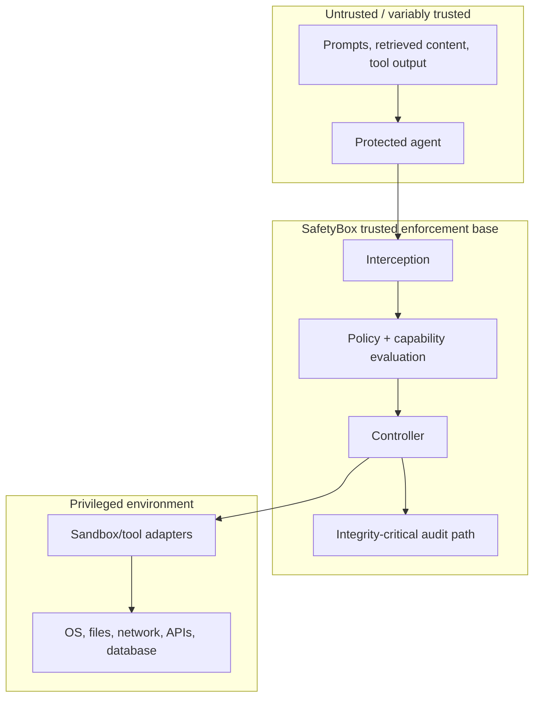

# Architectural Threat Boundaries

This view complements the canonical threat-model [Trust Boundaries](../threat-model/TRUST_BOUNDARIES.md) by locating controls in the architecture.

## Boundary assumptions

- The agent cannot reach privileged resources except through controlled adapters.
- Agent identity, session/task binding, contract/policy sources, and approval identities are authenticated.
- The host and isolation mechanisms enforce separation from policy, audit, and controller state.
- Adapters correctly bind authorization to actual operations and accurately report outcomes.
- External tools and their outputs may be compromised; their internal effects may be only partly observable.

Violating these assumptions can invalidate prevention claims. They must be tested where feasible and disclosed otherwise. SafetyBox does not replace host hardening or cryptographic identity systems.
