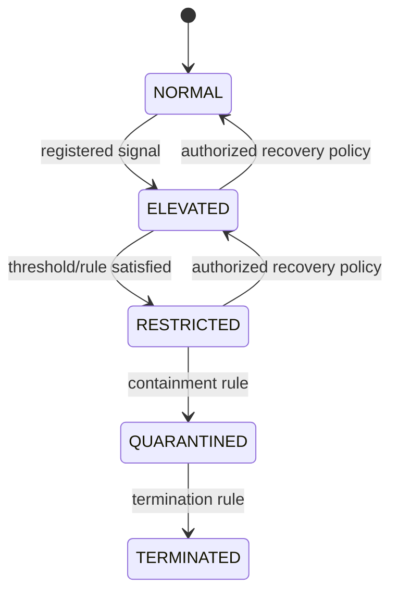

# Trust and Risk Model

## Scientific status

“Trust” and “risk” are experimental operational state variables, not validated measurements of intent, moral reliability, or real-world harm. Their value must be established against registered outcomes. No final weights or universal thresholds are specified here.

## Candidate state machine

- `NORMAL`: contract capabilities remain available.
- `ELEVATED`: monitoring or approvals may increase; authority must not expand.
- `RESTRICTED`: selected capabilities are revoked or narrowed.
- `QUARANTINED`: privileged external actions are blocked and evidence retained.
- `TERMINATED`: session is closed and cannot resume.

Recovery is not automatic unless a versioned policy defines evidence, waiting period, and approver authority. Terminal state is irreversible for that session.

## Candidate observable signals

- denied-action attempt or repeated denied actions;
- resource-scope deviation;
- unexpected tool sequence;
- sensitive resource access;
- privilege-escalation attempt;
- network destination deviation;
- repeated policy-boundary probing;
- abnormal action frequency;
- trajectory deviation;
- explicit prompt-injection indicators when available.

A signal is not necessarily malicious. Benign novelty, adapter error, a narrow contract, or operational recovery can produce similar telemetry.

## Risks of naive scoring

Arbitrary weighted sums can hide assumptions, double-count correlated signals, create brittle thresholds, encourage score gaming, and imply false precision. They may perform differently across tasks or frameworks and can penalize long tasks merely for generating more events. Initial work should favor interpretable state-transition rules. If weights are introduced, they require preregistered calibration data, held-out validation, sensitivity analysis, uncertainty reporting, and per-domain limitations.

State changes must name their signals/rules, emit `RISK_CHANGED`, and cause only policy-defined capability attenuation or containment.
