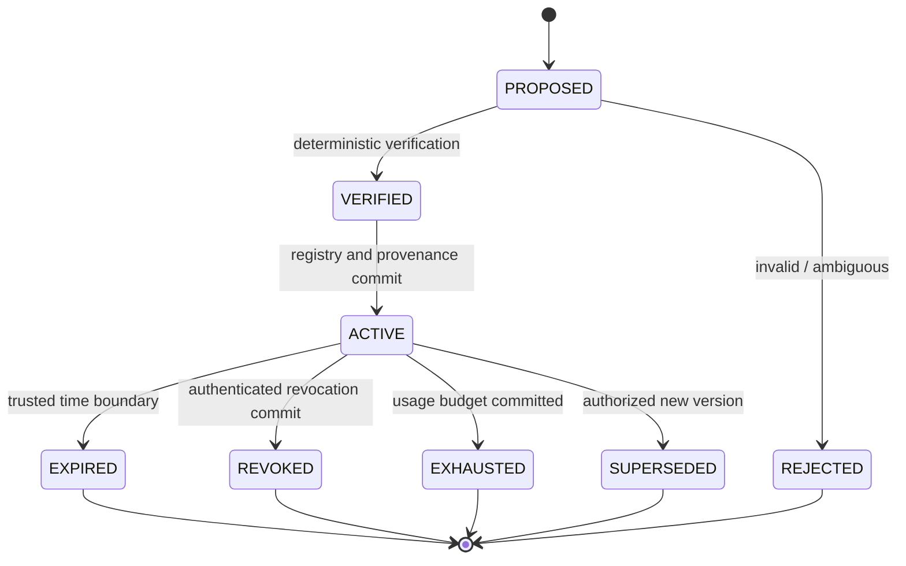

# SafetyBox Authority Model V2 Research Specification

## Status and purpose

**Specification identity:** `SAFETYBOX-AUTHORITY-MODEL-V2@1`

**Specification date:** 2026-09-25

Authority V2 is a research design, not an implemented schema or migration commitment.
The current implementation remains the immutable in-process `TaskContract` and exact
`Capability(action, resource)` model. V2 formalizes identity, delegation, attenuation,
expiry, revocation, use limits, destinations, provenance, and external approval before
any implementation is attempted.

## Semantic model

An authority object denotes a set of normalized requests that it may authorize. Let
`Requests(a, S)` be that set under trusted state `S`. Authority ordering is set inclusion:

```text
a_child <= a_parent  iff
forall q, S_valid:
    q in Requests(a_child, S_valid) => q in Requests(a_parent, S_valid)
```

This denotational rule is normative. Field-by-field checks are only an implementation of
it. V2 permits only typed constraint forms with a sound and complete-enough subset
procedure for supported combinations. Unsupported, ambiguous, or incomparable forms do
not delegate (`INV-031`). Natural-language descriptions never participate in authority
membership.

For request `q` at state `S`:

```text
MayAuthorize(a, q, S) :=
       IntegrityValid(a)
   and IssuanceChainValid(a, S)
   and IdentityBound(a, q, S)
   and TaskBound(a, q, S)
   and ActionMember(q.action, a.actions)
   and ResourceMember(q.resource, a.resource_scope)
   and ConstraintsSatisfied(a.constraints, q, S)
   and TimeValid(a, S.authoritative_time)
   and UsageAvailable(a, S)
   and not RevokedByChain(a, S)
```

An `ALLOW` requires at least one committed authority object for which `MayAuthorize` is
true, plus all independent system-policy and mediator checks. Possessing an authority
object is necessary but not sufficient to execute a protected primitive.

## Conceptual immutable schema

| Field | Meaning |
|---|---|
| `authority_id` | Globally unique opaque object identifier. |
| `schema_version` / `authority_version` | Interpretation and immutable revision identifiers. |
| `principal_id` | Authenticated accountable principal to which authority is bound. |
| `agent_id` / `session_id` | Optional authenticated execution subject restrictions; omission semantics must be explicit, never wildcard by accident. |
| `task_id` | Authenticated task-instance binding, not merely a caller-supplied equal string. |
| `actions` | Canonical finite action set or registered action scope. |
| `resource_scope` | Canonical registered resource set/pattern with resource-type-specific semantics. |
| `constraints` | Typed conjunctive limits: arguments, cwd, environment, sandbox, byte/row/rate/cost limits, and other registered predicates. |
| `destinations` | Typed outbound destination/method/purpose constraints where applicable. |
| `issuer_id` | Authenticated issuer principal or system policy. |
| `issued_at` / `not_before` / `expires_at` | Trusted temporal bounds with declared clock semantics. |
| `parent_authority_id` | Immediate source authority for a delegation; absent only for registered roots. |
| `delegation_depth` / `maximum_delegation_depth` | Current depth and non-increasing remaining delegation budget. |
| `usage_limit` | Maximum committed uses or quantities and defined reservation/commit rules. |
| `approval_reference` | External approval artifact where approval created this version. |
| `revocation_epoch` | Registry generation against which validity is checked; mutable revocation state is external to the immutable object. |
| `provenance_reference` | Integrity-protected issuance/compiler/rule record. |
| `integrity` | Signature, MAC, or trusted-registry reference under a specified threat model. |

Human descriptions, AI rationales, task context, memory, history, and trajectory findings
may be linked evidence but are excluded from the authority denotation.

## Identity and task binding

V2 distinguishes:

- **principal identity**: the person/service accountable for granting or exercising
  authority;
- **agent identity**: the protected agent instance or registered workload;
- **session identity**: one enforcement lifetime;
- **task identity**: one authenticated task instance and version;
- **delegation identity**: issuer, parent, child subject, and chain; and
- **authority source**: the authenticated root from which grant rights derive.

Equality of caller-supplied `task_id` values does not authenticate a task or principal.
An identity-binding mechanism and its replay boundary are prerequisites for claims under
`INV-025`. Provider/model identity is metadata unless trusted policy explicitly binds it;
it cannot substitute for principal or task authentication.

## Delegation

Delegation creates a new immutable child. It never mutates or lends the parent object.
Acceptance requires:

```text
Requests(child, S) subset Requests(parent, S)
Requests(child, S) subset MaximumPrivilege(child.task, S)
child.issuer_id is authorized by parent
child.parent_authority_id = parent.authority_id
child.delegation_depth = parent.delegation_depth + 1
child.maximum_delegation_depth <= parent.maximum_delegation_depth
```

The child must narrow or preserve every authority dimension:

| Dimension | Required relation |
|---|---|
| Principal/subject | exact parent-authorized delegate, never an inferred identity |
| Task | same authenticated task or an explicitly allowed descendant task subset |
| Action | child action set is a subset |
| Resource | child resource denotation is a subset after canonicalization |
| Constraints | child predicate implies every parent predicate |
| Time | child interval is contained in the parent's remaining interval |
| Usage | child allocation is bounded by a reserved or otherwise non-amplifying share |
| Destination | child destination/method set is a subset |
| Delegation | remaining depth and re-delegation permissions do not increase |

Multi-agent messages carry no authority by default. An authority-bearing message must
reference a verifiable child object, sender identity, receiver binding, task lineage, and
issuance record. Copying message text or an authority identifier is not delegation.

## Attenuation

Attenuation is creation of `a_narrow` such that `a_narrow <= a_source`. It may remove
actions/resources, strengthen constraints, shorten time, reduce use, restrict destination,
bind a narrower subject/task, or remove delegation rights.

Attenuation cannot add a permission in one dimension to compensate for narrowing another.
For example, fewer resources plus a new action is not attenuation. Constraint comparison
is conjunctive and type-specific. A syntactic difference is insufficient; the verifier
must prove semantic subset under the registered algebra.

Risk or trajectory policy may trigger a predefined attenuation operation, but the AI
finding itself is not authority. Restoring removed authority requires a separately
authorized new version; it is not “reverse attenuation.”

## Authority composition and compound requests

Implicit union is prohibited. A request is authorized by one covering object unless a
versioned policy explicitly supports composition and records all contributing authorities.
Composition must not manufacture a permission tuple that no component covers.

A compound operation is allowed only when its authorization semantics enumerate every
component and the final transition. For components `q_1..q_n`:

```text
CompoundAuthorized(Q, S) :=
    every q_i is covered under declared composition semantics
    and all cross-component constraints hold
    and the mediator can enforce atomicity/partial-effect semantics
```

Failure must expose which components were not started, occurred, failed, or are
indeterminate. “Tool allowed” is never sufficient authority for all sub-operations.

## Expiry

Expiry is deterministic and uses a trusted clock source and declared comparison rule.
The initial proposal is a half-open interval `[not_before, expires_at)`. At or after
`expires_at`, no new authorization ticket or primitive start may be committed.

AI cannot select or extend expiry except as an untrusted proposal checked against issuer
and system ceilings. Clock rollback, unavailable time, excessive skew, or unverifiable
time fails closed for new protected actions. Renewal creates a new authority object with
new provenance; it does not rewrite history.

## Revocation

Revocation is an authenticated, ordered registry transition. The commit sequence/epoch,
not an untrusted producer timestamp, defines when it takes effect.

Proposed semantics:

- **new actions:** authorization checks committed after revocation must deny;
- **queued/approved but not started:** revalidate immediately before primitive start;
- **authorization tickets:** short-lived, single-request, exact-input bindings and invalid
  when their authority epoch is stale;
- **children:** revoking an ancestor invalidates descendants for new effects unless a
  registered transfer semantics explicitly created an independent root beforehand;
- **cached capabilities:** caches must validate current epoch and cannot outlive expiry;
- **in-flight before primitive start:** stop and report denied/revoked;
- **primitive already started:** revocation does not imply rollback; record the actual
  outcome and attempt policy-defined cancellation only through a mediated capability; and
- **long-lived/descendant effects:** process, connection, descriptor, subscription, and
  child-agent lifecycle semantics must be defined per mediator. Revocation of launch
  authority alone does not prove termination of effects already created.

These semantics make `INV-033` precise at the **new primitive start** boundary without
overclaiming reversal of prior effects.

## Usage limits and concurrency

Usage-limited authority needs a trusted reservation protocol. “Check then increment” is
insufficient under concurrency. A mediator should atomically reserve a use before
primitive start, commit or release according to registered failure rules, and link the
reservation to the effect record. Delegating uses must reserve or partition the parent's
budget so siblings cannot each reproduce the full limit.

Exact semantics are required for retries, partial effects, crash recovery, and operations
whose quantity is known only after execution. Until implemented and tested, usage limits
remain conceptual.

## Approval

Approval is external authority creation, not a bypass:

```text
insufficient authority
  -> non-executing approval request with exact authority delta
  -> independently authenticated principal
  -> deterministic grant-scope verification
  -> new immutable, versioned authority
  -> registry/provenance commit
  -> fresh authorization of the original request
```

The approver must have authority to grant the entire delta. Approvals bind request/task,
scope, limits, expiry, use count, and recipient; stale or broadened replays fail. The agent
cannot approve itself, and an AI recommendation is not an approval.

## Authority lifecycle state machine



Terminal objects remain in provenance. Re-activation is prohibited; renewal or restored
scope creates a new object.

## Deterministic decision reasons

At minimum, V2 should distinguish `IDENTITY_UNVERIFIED`, `TASK_MISMATCH`,
`ACTION_OUT_OF_SCOPE`, `RESOURCE_OUT_OF_SCOPE`, `CONSTRAINT_FAILED`,
`DESTINATION_OUT_OF_SCOPE`, `NOT_YET_VALID`, `EXPIRED`, `REVOKED`, `ANCESTOR_INVALID`,
`USAGE_EXHAUSTED`, `DELEGATION_DEPTH_EXCEEDED`, `AMPLIFICATION_DETECTED`,
`AMBIGUOUS_SCOPE`, `INTEGRITY_FAILURE`, and `PROVENANCE_COMMIT_FAILURE`.

Reason specificity supports audit and stratified metrics but must not disclose secrets to
an untrusted agent. External error presentation may be coarser than protected audit data.

## Required research and verification before implementation claims

1. A versioned schema and canonical serialization with unknown-field policy.
2. Formal typed subset rules for each action/resource/constraint family.
3. Property tests proving accepted delegation examples are subsets and adversarial
   amplification examples are rejected.
4. Authenticated identity and issuer threat model, including replay.
5. Atomic registry, usage, expiry, and revocation concurrency semantics.
6. Parent/child invalidation and crash-recovery tests.
7. Approval-delta usability and authorization tests.
8. End-to-end mediator tests tying actual effects to exact authority versions.
9. Independent adversarial review and explicit unsupported constraint combinations.
10. Migration rules that preserve the current frozen artifacts and do not reinterpret
    historical evidence as V2 evidence.

## Non-claims

V2 does not by itself authenticate operating-system processes, provide complete mediation,
make an authorized operation semantically safe, revoke effects already produced, prove
natural-language task intent, or establish production-grade cryptographic provenance.
